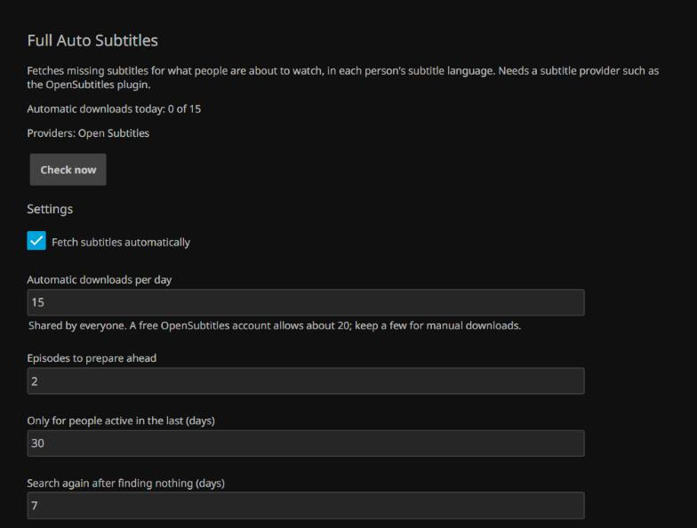
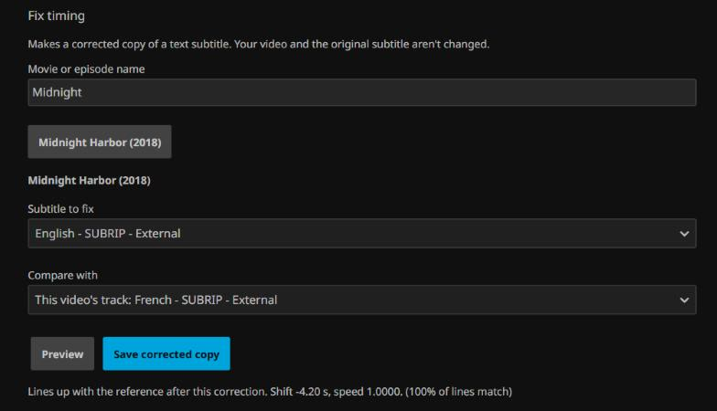

<p align="center">
  
</p>

<h1 align="center">Full Auto Subtitles</h1>

<p align="center">A Jellyfin plugin that gets missing subtitles before you press play, and fixes the ones that are out of sync.</p>

<p align="center">
  <a href="https://github.com/PraiseGodForAllEternity/jellyfin-plugin-full-auto-subtitles/releases/latest"></a>
  <a href="https://github.com/PraiseGodForAllEternity/jellyfin-plugin-full-auto-subtitles/releases"></a>
  
  <a href="https://github.com/PraiseGodForAllEternity/jellyfin-plugin-full-auto-subtitles/actions/workflows/build.yml"></a>
  <a href="LICENSE"></a>
</p>

## Features

- **Ready before you watch:** covers Continue Watching, Next Up, the next episodes and favorite movies.
- **Everyone's own language:** uses each person's subtitle language from their Jellyfin settings.
- **Better matches first:** prefers subtitles made for your exact file, and skips forced-only and machine-translated ones.
- **Shares your daily downloads:** one limit for the server, split fairly between users.
- **Fix timing:** corrects subtitles that are early, late or drifting. The original stays, and you can undo it.
- **Keeps your track choices:** saved audio and subtitle choices still point at the right track after a subtitle is added.

## Screenshots

| Settings | Fix timing |
|---|---|
|  |  |

## Requirements

- Jellyfin **10.11** or **12**
- A subtitle provider plugin, such as [Open Subtitles](https://github.com/jellyfin/jellyfin-plugin-opensubtitles) with a free [opensubtitles.com](https://www.opensubtitles.com) account

## Installation

1. In Jellyfin, open **Dashboard > Plugins > Manage Repositories** and add:

   ```
   https://raw.githubusercontent.com/PraiseGodForAllEternity/jellyfin-plugin-full-auto-subtitles/main/manifest.json
   ```

2. Go back to **Plugins** and change the filter from **Installed** to **Available**.
3. Install **Full Auto Subtitles**.
4. Install **Open Subtitles** too, if you don't have a provider yet. It's in Jellyfin's own list, under **Subtitles**.
5. Restart Jellyfin.
6. Enter your login in the **Open Subtitles** settings.

Jellyfin installs the right build for your version and keeps it updated. Versions ending in `.12` are for Jellyfin 12.

> If Open Subtitles isn't listed, make sure Jellyfin's own repository is still there: `https://repo.jellyfin.org/files/plugin/manifest.json`

## Usage

1. In your user settings, under **Subtitles**, choose your preferred language and a subtitle mode other than **None** or **Only Forced**.
2. That's it. The plugin checks every 6 hours and after something is watched. To start right away, use **Check now** on its settings page.

| Subtitle mode | When subtitles are fetched |
|---|---|
| Always Play | Whenever there are none in your language |
| Default, Smart | When the audio isn't in your language |
| Only Forced, None | Never |

**To fix a subtitle,** search for the title under **Fix timing**, pick the subtitle, and compare it with one that's in sync. Preview it, then save the corrected copy.

## FAQ

<details>
<summary>I don't see the plugin after adding the repository</summary>

The Plugins page shows only installed plugins at first. Change the filter to **Available** or **All**.
</details>

<details>
<summary>Nothing is being downloaded</summary>

Look at **Recent activity** on the settings page. Also check that a provider is listed at the top, that you're signed in to it, and that your user has a subtitle language set.
</details>

<details>
<summary>Why wasn't a subtitle ready the first time?</summary>

Subtitles are fetched ahead of time, so something nobody was expected to watch can be missed. Adding one renumbers a video's tracks in Jellyfin, so nothing is added while anyone is watching that movie or show.
</details>

<details>
<summary>Can it fix every subtitle?</summary>

It fixes a constant delay and a steady drift. It can't fix one made for a different cut, or picture-based subtitles (PGS, VobSub). [LAPSE](https://github.com/Schwponaco-org/lapse-jellyfin-plugin) can sync to the audio instead.
</details>

<details>
<summary>The audio or subtitle track looks wrong</summary>

If a movie's page was open while a subtitle was added, reopen the page. If it's still wrong, please open an issue.
</details>

## Testing status

**Tested** on Jellyfin 10.11.11 and 12.4 (Windows), with made-up media and a fake provider: fetching, download limits, saved track choices, Fix timing, undo, permissions and automatic install.

**Not tested yet:** real Open Subtitles downloads, Roku and other apps, Linux, 10.11.0 to 10.11.10, large libraries, several people watching at once, and two versions of one movie.

## Building

Requires the .NET 10 SDK.

```powershell
./build.ps1 -Version 1.0.0.0 -Changelog "What changed"
```

## Support

Found a bug or have an idea? [Open an issue](https://github.com/PraiseGodForAllEternity/jellyfin-plugin-full-auto-subtitles/issues). Changes are listed in the [changelog](CHANGELOG.md).

## License

[GPL-3.0](LICENSE). Not affiliated with Jellyfin or OpenSubtitles.
